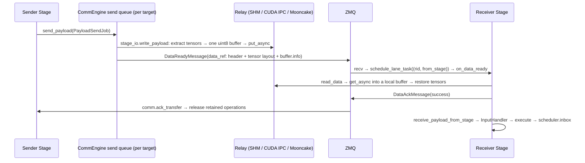

# Communication: how data moves between stages

This page covers the control plane, the transports, how a transport is chosen for each edge, and what each Qwen3-Omni edge actually uses, at commit `b62b0f94`. The repository's own reference is `docs/developer_reference/communication.md`. This page adds the per-edge view and the code locations. Everything here is static analysis.

## 1. Two planes

| Plane | Mechanism | Code |
| --- | --- | --- |
| Control | ZMQ sockets, messages serialized with msgpack (`serialize_message`, `pipeline/control_plane.py:50`) | `StageControlPlane` (`:283`), `CoordinatorControlPlane` (`:425`) |
| Data | same-process object reference, direct PyTorch CUDA IPC handles, or a relay buffer (SHM, pooled CUDA IPC, Mooncake) described by a `DataRef` inside a control message | `LocalStageDispatcher` (`pipeline/local_dispatch.py:27`), `CommEngine` (`comm/engine.py`), `CommRouter` (`comm/router.py:23`), `comm/stage_io.py`, `relay/*.py` |

### Socket topology

```text
Coordinator: PUSH ──► each stage's PULL        (SubmitMessage, AdminMessage, Shutdown, profiler control)
             PULL ◄── every stage's PUSH       (CompleteMessage, StreamMessage, AdminResultMessage)
             PUB  ──► every stage's SUB        (AbortMessage)
Stage:       PULL (bind) ◄── coordinator and upstream stages
             PUSH ──► each downstream stage's PULL   (DataReadyMessage, StreamChunkBatchMessage, DataAckMessage)
```

### Message vocabulary (`proto/messages.py`)

| Message | From → To | Carries |
| --- | --- | --- |
| `SubmitMessage` (`:387`) | Coordinator → entry stage | the first `StagePayload`, inline |
| `DataReadyMessage` (`:44`) | stage → stage | a payload or stream-chunk reference: `DataRef`, a direct CUDA IPC envelope, or an inline CPU envelope; `chunk_id`, or `is_done` / `error` for stream signals |
| `StreamChunkBatchMessage` (`:163`) | stage → stage | many small CPU stream chunks packed into one message (dtypes, shapes, bytes, pickled metadata) |
| `DataAckMessage` (`:235`) | receiver → sender | relay transfer done; the sender releases buffers |
| `StreamMessage` (`:346`) | terminal stage → Coordinator | a client-visible chunk (text dict, audio bytes dict) |
| `CompleteMessage` (`:315`) | any stage → Coordinator | a terminal result, or a failure (`success=False`) |
| `AbortMessage` (`:301`) | Coordinator → all (PUB) | request id only |

## 2. Transport selection

`CommRouter` (`comm/router.py:23`) picks the transport from locality and placement; there is no user-facing backend switch. In `Stage.send_to_stage` (`runtime.py:1965`) the order is:

```text
payload hop to target:
 1. target in same_process_targets and local send allowed   → LOCAL_OBJECT (LocalStageDispatcher.send_payload)
 2. payload has CUDA tensors and target in direct_cuda_ipc_targets
    and not disable_direct_cuda_ipc_payload                  → direct PyTorch CUDA IPC (DataReadyMessage with handles, no ACK)
 3. otherwise router.outbound_payload (router.py:301):
      remote stage                                           → MOONCAKE
      no tensors / only CPU tensors                          → SHM
      device tensors, both stages GPU                        → intra_node_transport: CUDA_IPC (pooled), or SHM if no peer access
```

`direct_cuda_ipc_targets` (`router.py:53`) holds targets in another process whose single GPU is the sender's own placement GPU. `cuda_ipc_peer_available` (`:67`) checks `torch.cuda.can_device_access_peer` for cross-GPU edges and falls back to SHM with a warning.

```text
stream chunk to target (Stage.send_stream_to_target, runtime.py:2361 / route_stream_run, :1603):
 1. same process                                             → local LocalStreamChunk (by reference, in order)
 2. CPU tensor ≤ 16 KiB, metadata without tensors            → packed into StreamChunkBatchMessage ("inline")  [BATCHED_STREAM_CHUNK_BYTES_LIMIT, runtime.py:84]
 3. CUDA tensor and direct CUDA IPC target                   → DataReadyMessage(direct envelope)  (metadata inline ≤ 64 KiB, stage_io.py:63)
 4. otherwise router.outbound_stream (router.py:233):
      remote → MOONCAKE; CPU tensor → SHM; GPU→GPU → CUDA_IPC pooled (or SHM)
stream signals (done / error)                                → control-only (local call or DataReadyMessage(is_done))
```

## 3. Relay-backed payload, end to end



- Sends to one target go through that target's queue (`CommEngine.send_payload`, `comm/engine.py:222`), so payloads to the same target keep their order.
- Receives are ordered per **lane** `(request_id, from_stage)` (`Stage.schedule_lane_task`, `runtime.py:589`). Different requests and different sources proceed in parallel.
- On a read failure, the receiver sends a negative ACK, cleans up and sends `send_failure` (`Stage.on_data_ready`, `runtime.py:762`).
- The control message is sent **before** waiting on the put. Credit-based backends need the receiver to start reading so the sender's credit is released (repository doc, "Streaming Flow").

## 4. Edges in practice

### Text config (`Qwen3OmniPipelineConfig`, everything in `process="pipeline"`)

| Edge | Transport |
| --- | --- |
| Coordinator → preprocessing | ZMQ `SubmitMessage` (process boundary) |
| preprocessing → mm_aggregate → thinker | `local_object` |
| thinker → decode, stream | local stream chunks |
| thinker → decode, payload | `local_object`; allowed because decode was recorded as a local stream target (`can_send_full_payload_locally`, `runtime.py:2193`) |
| decode → Coordinator | ZMQ `StreamMessage` / `CompleteMessage` (process boundary) |

### Speech config (`Qwen3OmniSpeechPipelineConfig`, one process per stage; thinker, encoders and code2wav on GPU 0, talker on GPU 1)

| Edge | Data | Transport (derived from the rules above) |
| --- | --- | --- |
| Coordinator → preprocessing | submit | ZMQ inline |
| preprocessing (no GPU) → thinker / talker_ar / encoders | CPU tensors | SHM relay |
| image/audio_encoder → thinker (same GPU 0, other process) | CUDA encoder outputs | image_encoder: direct CUDA IPC when its output holds CUDA tensors; audio_encoder sets `disable_direct_cuda_ipc_payload=True` (`config.py:131`), so it uses the pooled CUDA IPC relay |
| thinker → decode (decode has no GPU), stream | `tensor([token_id])` | inline batch |
| thinker → talker_ar (GPU 0 → GPU 1), stream | token tensor | inline batch |
| thinker → talker_ar, first chunk when the prompt has media | prompt hidden rows: CPU, pinned (`PromptHiddenStore.read`) | inline if ≤ 16 KiB, otherwise SHM relay |
| thinker → decode, payload | CPU data | SHM relay |
| talker_ar → code2wav (GPU 1 → GPU 0), stream | CUDA codec rows | pooled CUDA IPC relay if peer access, otherwise SHM |
| talker_ar → code2wav, payload | empty latch | SHM relay (no tensors) |
| decode, code2wav → Coordinator | text dict, audio bytes dict | ZMQ msgpack |

In the colocated config (`config.py:499`), code2wav shares the talker's process, so codec chunks go `local_object`. The talker attaches a CUDA event (`put_code_messages`, `talker_model_runner.py:231`) so code2wav waits on the GPU rather than syncing the host.

This table is derived from the selection rules and the default placement. To confirm the transports on a real run, enable the comm trace (`comm_transport_selected` events in `CommRouter.note_transport_choice`) or read the `transport` field of the `stage_hop_sent` and `stage_stream_chunk_sent` profiler events.

## 5. Lifetime, abort and cleanup

- **LOCAL_OBJECT:** no copy and no cleanup. The receiver must treat the object as read-only. Projections such as `project_thinker_to_decode` exist partly to avoid sharing mutable containers (`is_isolated_projected_payload`).
- **Direct CUDA IPC:** no relay ACK. PyTorch's IPC refcounting keeps the producer storage alive.
- **Pooled CUDA IPC:** the sender owns a GPU pool (slot granule `cuda_ipc_slot_size_kb`, 64 KiB by default). One logical ACK releases all slots of one envelope.
- **SHM:** blocks are unlinked on receive.
- **Abort:** `Stage.on_abort` (`runtime.py:2679`) → `comm.cleanup(request_id)` → `relay.cleanup` for every backend in use. Late `DataReadyMessage`s for aborted requests are discarded (`discard_data` / `discard_stream_chunk_data`).
- **Shutdown:** `relay.close()`.

## 6. Why it is built this way

- **Small, uniform control messages over ZMQ** keep routing simple and backend-neutral; bulk bytes never pass through the control socket except small inline chunks.
- **Placement-derived transport** (no config switch) means moving a stage to another GPU or process changes the transport automatically. The cost is that you must read the router to know which one an edge uses.
- **Inline batching for tiny CPU chunks:** a thinker token is 8 bytes, and a relay round trip per token would dominate. Packing chunks into one `StreamChunkBatchMessage` per target per drain cycle amortizes the cost.
- **Per-lane ordering** gives each request its ordering guarantee without serializing unrelated requests.
