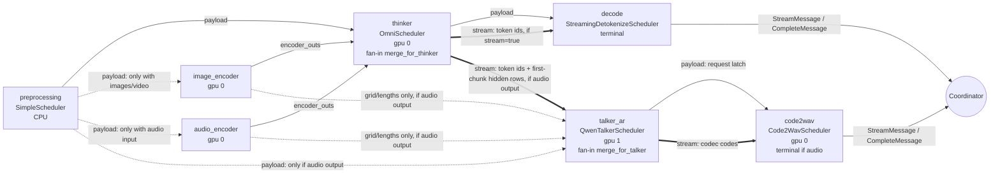
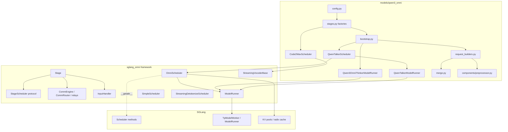

# Qwen3-Omni multi-stage pipeline (text + audio)

This page covers the speech pipeline `Qwen3OmniSpeechPipelineConfig` at commit `b62b0f94`: how the stage graph is built from config, which stages a given request actually visits, and how thinker, talker and code2wav cooperate while streaming. The text-only path is in [request_trace.md](request_trace.md). Everything here is read from code (STATIC). No timings are claimed.

## 1. Which config, which stages

| Config class | Stages | Processes | GPUs (default) |
| --- | --- | --- | --- |
| `Qwen3OmniPipelineConfig` (`config.py:412`) | `text_stages()`: preprocessing, image_encoder, audio_encoder, mm_aggregate, thinker, decode | all in `pipeline` | encoders, aggregate, thinker on 0 |
| `Qwen3OmniSpeechPipelineConfig` (`config.py:425`) | `speech_stages()` (`config.py:268`): preprocessing, image_encoder, audio_encoder, thinker, decode, talker_ar, code2wav | one process per stage (`SPEECH_DEFAULT_PROCESSES`, `config.py:305`) | thinker, encoders, code2wav on 0; talker_ar on 1 |
| `Qwen3OmniSpeechColocatedPipelineConfig` (`config.py:499`) | same 7 stages | code2wav shares the talker's process (`COLOCATED_SPEECH_PROCESSES`, `config.py:318`) | everything on 0 |

Differences between the speech and text graphs:

- **No `mm_aggregate` stage.** The thinker itself does the fan-in (`wait_for=[preprocessing, image_encoder, audio_encoder]`, `merge_fn=merge_for_thinker`), and so does the talker (`merge_fn=merge_for_talker`). See `thinker_stage(speech_enabled=True)` (`config.py:150`) and `talker_stage` (`config.py:212`).
- **Two terminal stages:** `decode` and `code2wav`. `terminal_stages_fn = resolve_terminal_stages` (`request_builders.py:229`) narrows them per request: `[decode, code2wav]` if the request wants audio, otherwise `[decode]`.

## 2. Pipeline DAG (from config + route functions)



Solid lines are always taken, dashed ones depend on the request, and thick ones are streams. The routing decisions:

| Decision point | Function | Rule |
| --- | --- | --- |
| Preprocessing → ? | `resolve_preprocessing_next_stages_speech` (`request_builders.py:248`) | encoders with model inputs, then `thinker`, then `talker_ar` if `should_generate_audio_output` |
| Encoder → ? | `resolve_encoder_next_stages` (`:207`) | `[thinker, talker_ar]` if audio output, otherwise `thinker` |
| Thinker payload → ? | `resolve_thinker_next_stages` | always `decode` |
| Thinker stream_done → ? | `resolve_thinker_stream_done_targets` (`:218`) | `[talker_ar, decode]` if audio output, otherwise `[decode]` |
| Thinker stream chunks → ? | `make_thinker_stream_output_builder` (`:1162`) | `decode` if `params.stream`, plus `talker_ar` if audio output |
| Fan-in sources | `resolve_mm_aggregate_wait_sources` (`:264`) | `preprocessing` plus the encoders that are active for this request |
| Terminal stages | `resolve_terminal_stages` (`:229`) | `[decode, code2wav]` if audio output, otherwise `[decode]` |

**Gotcha: when "audio output" is on.** `should_generate_audio_output` (`request_builders.py:162`) returns True when `output_modalities` is **missing** or contains `"audio"`. The chat route always fills it (`req.modalities or ["text"]`), so over HTTP you get audio only with `"modalities": ["text", "audio"]`. A caller that builds `OmniRequest` itself and leaves the field out gets audio by default.

## 3. One text + audio request, step by step

Request: `{"messages": [...], "modalities": ["text", "audio"], "stream": true}` on the speech config, with no input media.

| # | Where | What happens | Evidence |
| --- | --- | --- | --- |
| 1 | HTTP → Client → Coordinator | as text steps 1–5, but `output_modalities=["text","audio"]` and `RequestInfo.terminal_stages={"decode","code2wav"}` | `coordinator.py:560`, `request_builders.py:229` |
| 2 | preprocessing (own process) | chat template + tokenize, then route to `[thinker, talker_ar]`. The payloads cross processes, so they travel by **SHM relay** (CPU tensors). | `request_builders.py:248`, `comm/router.py:301` |
| 3 | thinker Stage | fan-in on the preprocessing payload only (no active encoders), then `merge_for_thinker`, then `OmniScheduler` | `config.py:150`, `merge.py:47` |
| 4 | talker_ar Stage | fan-in on preprocessing only, then `merge_for_talker` (`request_builders.py:439`), which keeps only `prompt` and `thinker_inputs`. The payload goes to the scheduler, but the request is **not built yet** (see step 7). | `request_builders.py:439` |
| 5 | thinker request build | `thinker_max_new_tokens(params, speaks=True)` (`:186`) caps the thinker's budget at what the talker can say in `talker_max_new_tokens` codec frames. `capture_prompt_hidden_states` is on for request-mode speech. | `request_builders.py:186`, `bootstrap.py:22` |
| 6 | thinker decode steps | each token → `OutgoingMessage(stream)` to `decode` (stream=true) and to `talker_ar`. If the prompt had media, the first chunk to the talker carries the prompt's hidden rows (`prompt_hidden_store.read`, a CPU tensor). | `request_builders.py:1162`, `:1210` |
| 7 | talker ingress | chunks that arrive before the talker's payload is built sit in `pending_stream_ingress`; chunks for an already-built request are appended (`OmniScheduler.on_stream_chunk`, `omni_scheduler.py:3613`). `QwenTalkerScheduler.is_request_build_ready` (`talker_scheduler.py:97`) waits until ≥ `partial_start_min_chunks` usable chunks have arrived (5 in the default speech config, 1 when colocated), or stream_done. | `talker_scheduler.py:97`, `config.py:425`, `config.py:499` |
| 8 | talker request build | `build_talker_request_data` (`request_builders.py:1386`): `TalkerPrefillBuilder.build_prompt_prefill` turns the prefetched thinker chunks into talker prefill embeddings. Text that has not been consumed yet becomes `pending_text_queue`. Sampling defaults: temperature 0.9, top_k 50, repetition_penalty 1.05; the top 1024 codec ids are suppressed except EOS. | `request_builders.py:1280`, `:1386` |
| 9 | talker decode (feedback loop) | each decode input row = **previous step's codec feedback embedding + next thinker text embedding** (`combine_feedback_with_next_text`, `talker_model_runner.py:686`). A row whose next text has not arrived is **excluded** from the step and keeps its KV (`QwenTalkerScheduler.update_running_batch`, `talker_scheduler.py:142`; `ready_decode_rows`, `talker_model_runner.py:329`). | as cited |
| 10 | talker → code2wav stream | `QwenTalkerModelRunner.post_decode` → `emit_code_chunks_and_feedback` (`talker_model_runner.py:173`) emits codec rows **directly from the model runner** into the outbox. The first `codec_coalesce_early_frames` (=10) rows go one by one; after that, rows are coalesced 10 at a time. The finish hook flushes the remainder (`on_request_finished`, `:294`). | `config.py:212` factory args |
| 11 | code2wav | `Code2WavScheduler.ingest` (`code2wav_scheduler.py:385`) appends codes and drops the EOS row. When `stream_chunk_size` (10) new frames are ready, it decodes a window with `left_context_size` (25) frames of context, copies it to host via pinned slots, and `keep_audio` (`:802`) stores it. If streaming, it also emits `OutgoingMessage(stream, data=audio_waveform_payload(...))`, which goes to the coordinator as a `StreamMessage` with `modality="audio"`. Sample rate is 24000. | `code2wav_scheduler.py:222` |
| 12 | decode | text deltas → coordinator, as in the text trace | `streaming_detokenizer.py:142` |
| 13 | thinker finish | result → stream_done to `[talker_ar, decode]` → payload to decode | `request_builders.py:218` |
| 14 | talker finish | the request ends (codec EOS or budget). `result_adapter` returns the payload unchanged, and `project_talker_to_code2wav` (`request_builders.py:315`) sends code2wav only a **latch** (`{}`, or `{NO_SPEECH: True}`). Codes always travel on the stream. | `request_builders.py:1280`, `:315` |
| 15 | code2wav finish | stream_done + payload → flush the last window → `final_result_data` (`:930`): with streaming, only `{"modality": "audio", "sample_rate"}`; without, the full concatenated waveform. Then `CompleteMessage(from_stage="code2wav")`. | `code2wav_scheduler.py:930` |
| 16 | Coordinator | multi-terminal: `partial_results[rid]["decode"]` and `["code2wav"]`. When both have arrived, it resolves the future with `{"decode": ..., "code2wav": ...}`. The stream ends when both have completed. | `coordinator.py:881` |
| 17 | Client | non-stream: `default_result_builder` sees `"decode"` + `"code2wav"`, builds the text chunk from decode and attaches audio via `set_audio_data` (`client.py:687`). Then `completion` base64-encodes the WAV. Stream: each audio `StreamMessage` becomes `delta.audio.data` in SSE. | `client.py:766`, `openai_api.py:1229` |

**Short reply edge case:** if the thinker finishes before the talker has a single usable chunk, `QwenTalkerScheduler.complete_without_generation` (`talker_scheduler.py:114`) passes `{NO_SPEECH: True}` through, and code2wav returns empty audio instead of raising.

## 4. Sequence diagram (stream=true, audio output)

```mermaid
sequenceDiagram
    participant Co as Coordinator
    participant P as preprocessing
    participant T as thinker (gpu0)
    participant D as decode
    participant K as talker_ar (gpu1)
    participant W as code2wav (gpu0)
    Co->>P: SubmitMessage
    P->>T: payload (SHM)
    P->>K: payload (SHM)
    Note over K: payload waits in deferred_request_payloads
    T->>T: prefill
    loop every thinker token
        T->>D: token chunk (inline batch)
        T->>K: token chunk (inline batch; first may carry hidden rows via SHM)
        D->>Co: StreamMessage(text)
    end
    Note over K: ≥5 usable chunks → build talker Req → prefill
    loop every talker step (rows wait for next thinker text)
        K->>W: codec rows (CUDA IPC relay, coalesced ×10)
        W->>Co: StreamMessage(audio window)
    end
    T->>K: stream_done
    T->>D: stream_done + payload
    D->>Co: CompleteMessage(decode)
    K->>W: stream_done + latch payload
    W->>Co: CompleteMessage(code2wav)
    Note over Co: both terminals done → resolve / end stream
```

## 5. Scheduler timeline (qualitative, no durations)

```text
time ─────────────────────────────────────────────────────────────────────────►
preprocessing  [tokenize]
thinker              [prefill][d][d][d][d][d][d][d][d][d] ... [d] finish → stream_done
decode                         ·  ·  ·  ·  ·  ·  ·  ·  ·  ...     · finalize → Complete
talker_ar      (payload deferred) ......... [build][prefill][d][d]·[d][d]·[d] ... [d] finish
                                  ▲ 5th usable thinker chunk        ▲ row excluded: waiting for next text
code2wav                                              (buffer 10)[win][win]  ... [flush] → Complete
coordinator                    text deltas ...           audio windows ...        merge 2 terminals
```

The talker's start is gated by thinker chunks. Each talker decode step can also stall when the next thinker text row has not arrived. Code2wav emits audio only once a full window of new frames is buffered. These three gates are the structural parts of time-to-first-audio; how long each one takes has to be measured (`code2wav_first_audio` is a profiler event).

## 6. Data-flow graph: what each edge carries

| Edge | Carries | Shape / size (from code) | Transport (default speech config) |
| --- | --- | --- | --- |
| Coordinator → preprocessing | `SubmitMessage(StagePayload{raw_inputs})` | chat messages | ZMQ msgpack |
| preprocessing → thinker | `Qwen3OmniPipelineState` (prompt ids, mm inputs) | CPU tensors | SHM relay + `DataReadyMessage` + ACK |
| preprocessing → talker_ar | projected: prompt + thinker_inputs | CPU tensors | SHM relay |
| thinker → decode (stream) | `tensor([token_id])` | 8 bytes, int64 | inline in `StreamChunkBatchMessage` (≤ 16 KiB, `runtime.py:84`) |
| thinker → talker_ar (stream) | token tensor; first chunk may be prompt hidden rows (CPU, pinned) | rows × hidden | inline if ≤ 16 KiB, else SHM relay (`outbound_stream`, `router.py:233`) |
| thinker → decode (payload) | `project_thinker_to_decode` | lists + small tensors | SHM relay |
| talker_ar → code2wav (stream) | codec rows (CUDA) | `[codebooks]` or `[≤10, codebooks]` | GPU 1 → GPU 0: pooled CUDA IPC relay if peer access, else SHM (`intra_node_transport`, `router.py:159`) |
| talker_ar → code2wav (payload) | latch `{}` / `{NO_SPEECH}` | empty | SHM relay |
| decode / code2wav → Coordinator | `StreamMessage`, `CompleteMessage` | text dict / audio bytes dict | ZMQ msgpack |

In the colocated config, code2wav lives in the talker's process: the code chunks become `local_object`, and `put_code_messages` (`talker_model_runner.py:231`) attaches a CUDA event so code2wav waits for the codes on the GPU without a host sync.

## 7. Component dependency graph



## 8. The nine questions

1. **Why split into stages?** The parts have different shapes: CPU preprocessing, batched encoders, two AR models with independent KV caches and batch sizes (thinker up to 64 running, talker 32: `TALKER_MAX_RUNNING_REQUESTS`, `config.py:37`), and a windowed vocoder. As separate stages they pipeline: the talker starts after 5 thinker tokens, and code2wav after 10 codec frames. Each also gets its own GPU, process and batching policy.
2. **Process, thread, or logical module?** A stage is a logical module (`Stage` + scheduler). `process=` in config decides which stages share an OS process (one asyncio loop, one failure domain). Each scheduler always runs in its own thread (`Stage.start`, `runtime.py:273`).
3. **Own scheduler per stage?** Yes. Every stage has exactly one scheduler object, built by its `factory_path`. AR stages each embed their own SGLang scheduler state and KV pool.
4. **How are dependencies and data passed?** Static edges come from `next`, `stream_to` and `wait_for`. Per-request narrowing comes from `route_fn`, `stream_done_to_fn`, `wait_for_fn` and `terminal_stages_fn`. Payloads go through `send_to_stage` (with a `project_payload` per target); streams go through `send_stream_to_target`.
5. **Control messages vs tensor payloads?** ZMQ carries small msgpack control messages: Submit, DataReady, StreamChunkBatch, Complete, Stream, Abort and DataAck. Tensors either ride inline (≤ 16 KiB CPU stream chunks, small submit payloads) or go through a relay buffer (SHM, CUDA IPC pool, Mooncake), with only a `DataRef` in the control message. See [communication.md](communication.md).
6. **Streaming lifecycle?** Open (stage `stream_queue.open`, or pre-payload when `can_accept_stream_before_payload`) → chunks (`stream_chunk` into the inbox, numbered per target) → `stream_done` signal (sent by `route_result` before the payload) → the consumer finalizes when it has both done and the payload → the terminal sends `CompleteMessage` → the Coordinator ends the client stream once all expected terminals have completed.
7. **Failure, abort, backpressure?** Failure: any stage error → `CompleteMessage(success=False)` → Coordinator fail-fast + `AbortMessage` broadcast. Abort: PUB/SUB to every stage → `Stage.on_abort` → `scheduler.abort` + relay cleanup. Backpressure, as admission limits rather than flow control: Coordinator `max_in_flight` (`resolve_coordinator_max_in_flight`, `config/topology.py:157`, derived from engine `max_running_requests` + `max_queued_requests`); per-AR-stage `waiting_queue_is_full` (`omni_scheduler.py:1764`) → `QueueFullError` (503); stream backlog bytes at the Coordinator; bounded relay pools/credits on the send side. Inside a request, the talker stalls rows waiting for text instead of dropping them.
8. **GPU and memory per stage?** `gpu=` places the stage. AR stages get SGLang `mem_fraction_static` (the thinker leaves `encoder_mem_reserve=0.05` for colocated encoders, `stages.py:1230`), code2wav gets `gpu_memory_fraction=0.02` (`config.py:245`), and the colocated config uses explicit per-stage fractions from its config file. Each AR stage builds its own KV pool via `create_sglang_infrastructure` (`scheduling/bootstrap.py:109`).
9. **Reused from SGLang?** The scheduler algorithms (batch selection, chunked/mixed prefill, retraction, `process_batch_result`), `Req` / `ScheduleBatch` / `ForwardBatch`, `TpModelWorker` and its model forward, KV pools and radix cache, CUDA graph runners, samplers, and `ServerArgs` (as `engine.*`). Not reused: SGLang's tokenizer/detokenizer processes and HTTP server. Those are replaced by Stage, Coordinator and Client.

## Not verified here

- Talker prefill internals (`TalkerPrefillBuilder`, `components/talker_prefill.py`) are only summarized.
- Code2wav CUDA-graph window shapes and the pinned-slot pool are only summarized.
- Encoder stages with real media were not traced.
