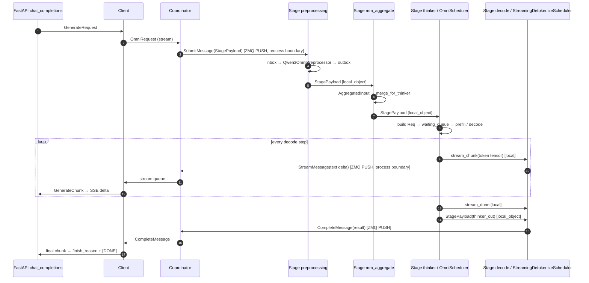

# Request Trace: one Qwen3-Omni text request

This page follows one `POST /v1/chat/completions` request through the Qwen3-Omni text-only pipeline (`Qwen3OmniPipelineConfig`), from the FastAPI handler to the HTTP response. Every step names the real function and its location at commit `b62b0f94`. Line numbers drift as the code changes, so search for the function name if a number is off.

This is a static trace derived from reading the code. It is not a recording of a run. No step here carries a duration. The text + audio path is in [qwen3_omni_pipeline.md](qwen3_omni_pipeline.md); transports in [communication.md](communication.md); scheduling in [scheduler_deep_dive.md](scheduler_deep_dive.md). To see real timings, record a run with the request-level profiler (`docs/developer_reference/profiler.md`) and load its JSONL into the interactive explorer.

## The request

```bash
curl http://localhost:8000/v1/chat/completions -H 'Content-Type: application/json' -d '{
  "messages": [{"role": "user", "content": "What is the capital of France?"}],
  "max_tokens": 64,
  "stream": true
}'
```

No images, audio or video, and no `modalities` field, so `output_modalities` defaults to `["text"]`. The trace covers `stream: true` and `stream: false`. Where they differ, the step says so.

## The topology this request runs on

`Qwen3OmniPipelineConfig` (`sglang_omni/models/qwen3_omni/config.py:412`) takes its stages from `text_stages()` (`config.py:257`):

```text
preprocessing ──► image_encoder ─┐
      │      └──► audio_encoder ─┤        (skipped: no media in this request)
      └─────────────────────────►┴──► mm_aggregate ──► thinker ──► decode (terminal)
                                                          └── stream_to=["decode"]
```

| Stage | Factory | Scheduler class | Role |
| --- | --- | --- | --- |
| `preprocessing` (entry) | `create_preprocessing_executor` (`stages.py:1003`) | `SimpleScheduler` | Chat template, tokenize, load media |
| `image_encoder` | `create_image_encoder_executor` | `SimpleScheduler` | Not reached for this request |
| `audio_encoder` | `create_audio_encoder_executor` | `SimpleScheduler` | Not reached for this request |
| `mm_aggregate` | `create_aggregate_executor` (`stages.py:1052`) | `SimpleScheduler` (identity) | Fan-in point; the merge happens in `AggregatedInput` |
| `thinker` | `create_sglang_thinker_executor_from_config` (`stages.py:1230`) | `OmniScheduler` | SGLang autoregressive LLM |
| `decode` (terminal) | `create_decode_executor` (`stages.py:1221`) | `StreamingDetokenizeScheduler` | Token ids to text |

The entry stage is the first stage in the list (`PipelineConfig.resolved_entry_stage`, `sglang_omni/config/schema.py:939`). Terminal stages are those with `terminal=True` (`schema.py:947`), so here that is only `decode`.

All six stages declare `process="pipeline"`, so they run in **one OS process**. The HTTP server, `Client` and `Coordinator` run in a **different** process: the one running `run_server` (`sglang_omni/serve/launcher.py:683`). The trace therefore crosses a process boundary exactly twice: once going in (`SubmitMessage`) and once per event coming back (`StreamMessage`, `CompleteMessage`). Hops between stages inside the pipeline process pass Python objects by reference through `LocalStageDispatcher` (`sglang_omni/pipeline/local_dispatch.py:27`).

## Concurrency model in one picture

```text
HTTP process                                  pipeline process (process="pipeline")
──────────────                                ─────────────────────────────────────
asyncio loop:                                 asyncio loop (run_process, stage_workers.py:807):
  uvicorn / FastAPI handler                     Stage.run() × 6            ← ZMQ PULL recv loop
  Client.generate (async gen)                   Stage.abort_listener × 6   ← ZMQ SUB
  Coordinator.submit_request                    Stage.drain_outbox × 6     ← waits on outbox via 1-thread executor
  Coordinator.run_completion_loop ← ZMQ PULL
                                              threads:
                                                scheduler-preprocessing  (SimpleScheduler.start)
                                                scheduler-mm_aggregate   (SimpleScheduler.start)
                                                scheduler-thinker        (OmniScheduler.start → SGLang forward)
                                                scheduler-decode         (StreamingDetokenizeScheduler.start)
                                                ...encoders likewise
```

`Stage` code runs on the asyncio loop. Each scheduler runs in its own thread, started by `Stage.start` (`sglang_omni/pipeline/stage/runtime.py:273`). The two sides talk only through `scheduler.inbox` and `scheduler.outbox`, which are thread-safe `queue.Queue`s of `IncomingMessage` and `OutgoingMessage` (`sglang_omni/scheduling/message.py:17`, `:24`).

## Object transformations

| Where | Type | Defined at | What it holds |
| --- | --- | --- | --- |
| HTTP body | `ChatCompletionRequest` | `serve/protocol.py:135` | OpenAI fields plus omni extensions |
| HTTP → Client | `GenerateRequest` | `client/types.py:145` | `messages`, `SamplingParams`, `output_modalities`, `metadata` |
| Client → Coordinator | `OmniRequest` | `proto/request.py:36` | `inputs` (message list), `params` (flat dict of sampling and stream settings), `metadata` |
| Coordinator → stages | `StagePayload` | `proto/request.py:61` | `request_id`, `request: OmniRequest`, `data` (starts as `{"raw_inputs": ...}`) |
| Wire (coordinator → entry) | `SubmitMessage` | `proto/messages.py:387` | the `StagePayload`, plus `replica_bindings` |
| Stage → scheduler | `IncomingMessage` | `scheduling/message.py:17` | `type` is `new_request`, `stream_chunk` or `stream_done` |
| Scheduler → stage | `OutgoingMessage` | `scheduling/message.py:24` | `type` is `result`, `stream` or `error`; `target` names a stage, or is `None` for the coordinator |
| `StagePayload.data` | `Qwen3OmniPipelineState` (a dict on the wire) | `models/qwen3_omni/payload_types.py:102` | `prompt`, `mm_inputs`, `encoder_inputs`, `thinker_inputs`, `thinker_out`, `engine_outputs`, `stream_state` |
| Inside thinker | `SGLangARRequestData` wrapping a SGLang `Req` | built in `request_builders.py:766` | the SGLang request plus a back-pointer to the `StagePayload` |
| Terminal stage → wire | `StreamMessage` / `CompleteMessage` | `proto/messages.py:346`, `:315` | text delta dict / final decode result dict |
| Client → HTTP | `GenerateChunk` → `CompletionStreamChunk` / `CompletionResult` | `client/types.py:190` | text, finish_reason, usage |

## Step-by-step

Each step lists the function, its caller, the boundary it sits on, and whether it is a control-plane event, a data-plane event or a compute step.

### 1. FastAPI handler

- **Function:** `chat_completions`, registered by `register_chat_completions` (`sglang_omni/serve/openai_api.py:1042`)
- **Caller:** uvicorn / FastAPI. **Callee:** `build_chat_generate_request`, then `chat_stream` or `chat_non_stream`
- **In / out:** `ChatCompletionRequest` → `StreamingResponse` (SSE) or `JSONResponse`
- **State:** assigns `request_id` (`req.request_id` or a fresh uuid4) and `response_id = f"chatcmpl-{request_id}"`
- **Boundary:** HTTP process, asyncio loop
- **Errors:** pydantic validation fails with 422 before this function runs
- **Why:** the HTTP layer only translates the protocol. It never touches stages.

### 2. Build the GenerateRequest

- **Function:** `build_chat_generate_request` (`openai_api.py:1387`)
- **In / out:** `ChatCompletionRequest` → `GenerateRequest` (`client/types.py:145`)
- **What happens:** normalizes `stop` into a list. Builds a client `SamplingParams` with `max_new_tokens = req.effective_max_tokens`. Converts messages to `Message`. Sets `output_modalities = req.modalities or ["text"]`. Moves media URLs and video options into `metadata`, and talker overrides into `extra_params`.
- **Why:** this is the one place where OpenAI field names become runtime names.

### 3. Client turns GenerateRequest into OmniRequest

- **Function:** `Client.generate` (`sglang_omni/client/client.py:181`), which calls `Client.build_omni_request` (`client.py:751`). That uses `extract_inputs` (`client.py:1004`) and `build_params` (`client.py:1147`).
- **Caller:** `Client.completion_stream` (stream) or `Client.completion` (non-stream), both called from `openai_api.py`
- **In / out:** `GenerateRequest` → `OmniRequest(inputs=[{"role":"user","content":...}], params={temperature, ..., max_new_tokens, stream}, metadata={output_modalities: ["text"], ...})`
- **Branch:** if `request.stream`, the client iterates `coordinator.stream(...)`. Otherwise it awaits `coordinator.submit(...)` once.
- **Why:** `inputs` stays a plain message list when the request has no media (`extract_inputs`). The preprocessor accepts both shapes.

### 4. Coordinator admits the request

- **Function:** `Coordinator.stream` (`sglang_omni/pipeline/coordinator.py:497`) or `Coordinator.submit` (`coordinator.py:485`). Both call `Coordinator.submit_request` (`coordinator.py:560`).
- **What happens, in order:**
  1. Rejects the request if the coordinator is in a fatal state, if the ID is already in use, or if `max_in_flight` is reached (`QueueFullError`, which the API maps to 503).
  2. `assign_replica_bindings` picks a replica per replicated process. Here nothing is replicated.
  3. Records `RequestInfo(state=PENDING, terminal_stages={"decode"})` in `self.requests`.
  4. Creates a completion `asyncio.Future`, plus a stream queue and a `StreamBacklog` when streaming.
  5. Wraps the request: `StagePayload(request_id, request, data={"raw_inputs": request.inputs})` (`coordinator.py:653`).
  6. Emits the profiler event `request_admission`.
  7. Sends a `SubmitMessage` to the entry stage, then sets `state = RUNNING`.
- **Boundary:** HTTP process, asyncio loop. **Plane:** control.
- **Errors:** if the send raises, the request is removed and the future released. No stage holds it yet, so there is nothing to abort.
- **Why:** the Coordinator owns the request lifecycle (admission, terminal collection, abort) and nothing model-specific.

### 5. ZMQ submit to the entry stage

- **Function:** `CoordinatorControlPlane.submit_to_stage` (`sglang_omni/pipeline/control_plane.py:449`) → `PushSocket.send` (`control_plane.py:86`)
- **What happens:** lazily connects a ZMQ `PUSH` socket to the preprocessing stage's endpoint, serializes the message with `serialize_message` (msgpack) and sends it.
- **Boundary:** **process boundary** (HTTP process → pipeline process). **Plane:** control. The `StagePayload` rides inside the control message, because the first payload is small (just the chat messages).

### 6. Preprocessing stage receives and dispatches

- **Function:** `Stage.run` (`sglang_omni/pipeline/stage/runtime.py:466`) → `Stage.handle_message` (`:539`) → `Stage.on_submit` (`:732`) → `Stage.execute` (`:1260`)
- **What happens:** `on_submit` refuses a request ID that was retired after an abort. Otherwise it adds the ID to `active_requests`, opens a `stream_queue` slot, emits `stage_input_received` and calls `execute`. `execute` wraps the payload as `IncomingMessage(type="new_request", data=payload)` and calls `scheduler.enqueue(msg)`, or falls back to `scheduler.inbox.put(msg)`.
- **Boundary:** pipeline process. This is the **asyncio → scheduler thread** hand-off.
- **Why:** `Stage` is an IO shell and never branches on scheduler type. Every scheduler exposes the same inbox/outbox interface.

### 7. Preprocessing compute

- **Function:** `SimpleScheduler.start_serial` (`sglang_omni/scheduling/simple_scheduler.py:305`) → `run_single` (`:225`) → `Qwen3OmniPreprocessor.__call__` (`sglang_omni/models/qwen3_omni/components/preprocessor.py:508`) → `call_impl` (`:672`) → `finalize_state` (`:524`)
- **What happens:** `call_impl` wraps the list as `{"messages": [...]}` and splits content parts. It runs `self.processor.apply_chat_template(..., add_generation_prompt=True, tokenize=False)` (`preprocessor.py:782`) and validates the prompt length against `max_new_tokens`. It loads media concurrently (none here), then tokenizes. `finalize_state` writes `Qwen3OmniPipelineState(prompt={prompt_text, input_ids, attention_mask}, mm_inputs, encoder_inputs, stream_state={"token_ids": [], "text": ""})` into `payload.data`. It then **clears `payload.request.inputs`** and removes media from metadata, so raw media is not copied on every later hop.
- **Boundary:** scheduler thread (`scheduler-preprocessing`). Async code runs on the thread's private event loop via `loop.run_until_complete`. **Plane:** compute (CPU).
- **Output:** `SimpleScheduler.emit_result` puts `OutgoingMessage(type="result", data=payload)` on the outbox.
- **Errors:** an exception becomes `OutgoingMessage(type="error")`. The stage turns that into `send_failure`, which sends a `CompleteMessage(success=False)` to the coordinator.
- **Why serial:** the factory comment explains that threaded dispatch changes how thinker batches form, which changed greedy bf16 MoE answers in CI. So `max_concurrency` defaults to 1.

### 8. Route the preprocessing result

- **Function:** `Stage.drain_outbox_external` (`runtime.py:1517`) → `Stage.route_result` (`runtime.py:1783`)
- **What happens:** the drain waits for `outbox.get` on a one-thread executor, then handles messages in batches. For a `result`, `route_result` calls `self.get_next(request_id, result)` (`runtime.py:1827`). For preprocessing, that is the config's `route_fn`: `resolve_preprocessing_next_stages` (`sglang_omni/models/qwen3_omni/request_builders.py:237`). It returns the encoder stages that have model inputs, then `"mm_aggregate"`. With no media the result is `["mm_aggregate"]`.
- **Plane:** control decision. **Why:** routing is data-driven per request, so a text-only request skips the encoders entirely even though they exist in the topology.

### 9. Hop: preprocessing → mm_aggregate

- **Function:** `Stage.send_to_stage` (`runtime.py:1965`)
- **What happens:** applies the projection `project_preprocessing_to_mm_aggregate` (`request_builders.py:401`), which keeps only the prompt, lightweight `mm_inputs`, encoder-input metadata and stream state. Both stages share `process="pipeline"` and this is a single-target route, so it takes the `local_object` path: `LocalStageDispatcher.send_payload` (`local_dispatch.py:56`) directly awaits `target.receive_local_payload(...)`. Profiler event: `stage_hop_sent{transport: "local_object"}`.
- **Plane:** data. No serialization, no ZMQ, no relay.
- **Rule:** the receiver must treat the object as read-only (`docs/developer_reference/communication.md`).

### 10. Fan-in at mm_aggregate

- **Function:** `Stage.receive_local_payload` (`runtime.py:821`) → `receive_payload_from_stage` (`:872`) → `AggregatedInput.receive` (`sglang_omni/pipeline/stage/input.py:44`)
- **What happens:** the stage's static `wait_for` is `["preprocessing", "image_encoder", "audio_encoder"]`. On the first arrival, `wait_for_fn = resolve_mm_aggregate_wait_sources` (`request_builders.py:264`) narrows that per request to `["preprocessing", *active_encoder_stages]`, which is `["preprocessing"]` here. All expected sources are present, so it immediately calls `merge_fn = merge_for_thinker` (`sglang_omni/models/qwen3_omni/merge.py:47`). That builds `thinker_inputs` and clears `encoder_inputs` and `encoder_outs`. Then `execute(merged)` runs.
- **State:** `AggregatedInput.pending[request_id]` exists only until the merge completes.
- **Why:** the merge runs in the Stage's input handler, before the scheduler. The mm_aggregate scheduler is an identity function (`create_aggregate_executor`, `stages.py:1052`).

### 11. mm_aggregate → thinker

Same as steps 6–9: the identity `SimpleScheduler` returns the payload, `route_result` follows the static `next="thinker"`, and the hop is a `local_object` dispatch.

### 12. Thinker stage enqueues into OmniScheduler

- **Function:** `Stage.execute` → `OmniScheduler.enqueue` (`sglang_omni/scheduling/omni_scheduler.py:1285`)
- **What happens:** with early request builds enabled, `start_early_request_build` may submit the request build to a thread pool from the stage thread, ahead of the scheduler loop. Either way the message goes into `inbox`.

### 13. Scheduler loop picks the request up and builds a SGLang Req

- **Function:** `OmniScheduler.start` (`omni_scheduler.py:3659`) → `event_loop_async_decode` (`:5059`). Async decode is the thinker default when speculative decoding is off; see `create_sglang_thinker_executor_from_config`. One iteration runs `recv_requests` (`:1346`) → `process_input_requests` (`:1522`) → `run_request_builder` (`:1708`) → `request_builder`, the closure from `make_thinker_scheduler_adapters` (`request_builders.py:1227`) → `build_sglang_thinker_request` (`request_builders.py:766`)
- **What happens:** `build_sglang_thinker_request` reads `state.prompt["input_ids"]`. It builds SGLang `SamplingParams` from `payload.request.params`, then calls `normalize(tokenizer)` and `verify(vocab_size)`. It constructs `QwenThinkerRequest(rid, origin_input_ids, sampling_params, vocab_size)`, a subclass of SGLang's `Req`. With no media it skips M-RoPE and multimodal positions. It returns `SGLangARRequestData(req=req, input_ids, ...)` and sets `req_data.stage_payload = payload`.
- **Boundary:** `scheduler-thinker` thread. The build may run on the request-build executor.
- **Errors:** a build failure calls `emit_request_error`, which produces an `OutgoingMessage(type="error")`, and then `abort(req_id)`.

### 14. Admission into SGLang's waiting queue

- **Function:** `OmniScheduler.enqueue_built_request` (`omni_scheduler.py:2026`)
- **What happens:** rejects the request if it has no prompt tokens. Checks request limits (context length) and KV capacity (`request_kv_capacity_error`). Selects the decode path. Then, under `request_admission_lock`, it sets `req.omni_data = req_data` and calls `self.waiting_queue.append(req)` (`:2178`). Profiler event: `scheduler_queue_enter`.
- **Why:** from this point the request is an ordinary SGLang `Req`. Batch selection, prefix (radix) cache, chunked prefill and KV allocation are all upstream SGLang.

### 15. Upstream SGLang picks a prefill batch

- **Function:** `self.get_next_batch_to_run()`. This is not defined on `OmniScheduler`. `OmniScheduler.__getattr__` (`omni_scheduler.py:1183`) looks it up on the upstream SGLang `Scheduler` class and binds it to this instance.
- **Why composition and not inheritance:** sglang-omni reuses SGLang's scheduling algorithms but overrides `recv_requests`, `process_input_requests`, `run_batch` and `stream_output`, so that requests come from the stage inbox and results go to the stage outbox instead of to SGLang's tokenizer and detokenizer processes.
- **Thinker defaults** (`stages.py:1230`): `max_running_requests=64`, `chunked_prefill_size=8192`, `enable_mixed_chunk=True`. The factory comment measured +14% throughput from mixed chunk under concurrent streaming.

### 16. Model forward

- **Function:** `OmniScheduler._run_batch` (`omni_scheduler.py:2972`) → `ModelRunner.execute` (`sglang_omni/model_runner/base.py:432`) → `build_forward_batch` (`:606`) → `prepare_and_forward` (`:654`)
- **What happens:** `build_sched_output` wraps the `ScheduleBatch` as `SchedulerOutput(requests=[SchedulerRequest(rid, req.omni_data)], batch_data=batch)`. `prepare_and_forward` calls `before_prefill`. For Qwen, `Qwen3OmniThinkerModelRunner.before_prefill` (`sglang_omni/models/qwen3_omni/thinker_model_runner.py:352`) attaches text input embeddings as a sidecar; with audio it composes multimodal embeddings. Then it calls `custom_prefill_forward`, which returns `None` here, and then the plain SGLang path `self.tp_worker.forward_batch_generation(forward_batch)` (`base.py:683`). It samples the next token, then `finalize` (`base.py:935`) builds a `ModelRunnerOutput`.
- **Decode steps:** later steps for this request are decode batches. `event_loop_async_decode` launches them with `run_batch_launch` (`omni_scheduler.py:3243`) and resolves each one an iteration later, so CPU scheduling overlaps GPU execution.
- **Boundary:** `scheduler-thinker` thread, GPU.

### 17. Per-token stream output (stream=true only)

- **Function:** `OmniScheduler.emit_stream_output` (`omni_scheduler.py:3128`) → `stream_output_builder`, the closure from `make_thinker_stream_output_builder` (`request_builders.py:1162`)
- **What happens:** for each request in the step, the builder checks `payload.request.params["stream"]`. If it is true, the builder emits `OutgoingMessage(type="stream", data=torch.tensor([token_id]), target="decode", metadata={"token_id": token_id})`. Middle chunks of a chunked prefill are skipped. All of a step's messages go into the outbox under one lock (`put_messages`).
- **Non-stream:** `stream_targets` is empty, so nothing is emitted per token. The text arrives only with the final result.

### 18. Thinker → decode stream hop (stream=true only)

- **Function:** `Stage.drain_outbox_external` collects consecutive targeted stream messages → `Stage.route_stream_run` (`runtime.py:1603`). Decode is a same-process target, so it calls `LocalStageDispatcher.send_stream_chunks` → `decode.receive_local_stream_chunks` (`runtime.py:831`) → `route_stream_item` (`:1255`), which puts `IncomingMessage(type="stream_chunk")` into the decode scheduler's inbox.
- **Plane:** streaming data. **Ordering:** each request's chunks keep their order; see the note in `route_stream_run`.
- **Why `can_accept_stream_before_payload=True` on decode** (`config.py:192`): decode receives token chunks before the thinker's final payload, so it must accept a stream for a request it has no payload for yet.

### 19. Detokenize (stream=true only)

- **Function:** `StreamingDetokenizeScheduler.on_stream_chunk` (`sglang_omni/scheduling/streaming_detokenizer.py:142`)
- **What happens:** appends the token id to `pending_tokens`, then decodes them with `skip_special_tokens=True`. If the text ends with U+FFFD (an incomplete UTF-8 sequence), it waits for more tokens. Otherwise it clears the pending tokens and emits `OutgoingMessage(type="stream", target=None, data={"text", "modality": "text", "stage_name": "decode"})`.
- **Boundary:** `scheduler-decode` thread.

### 20. Decode stream → Coordinator (stream=true only)

- **Function:** decode `Stage.drain_outbox_external`. An untargeted stream on a stage with no `stream_targets` goes to `Stage.send_stream_to_coordinator` (`runtime.py:2519`).
- **What happens:** requires `is_terminal`. Numbers the chunk per `(request_id, "coordinator")`, builds `StreamMessage(request_id, from_stage="decode", chunk=data, modality="text", chunk_id)` and sends it on the coordinator `PUSH` socket. Profiler events: `stage_first_stream_chunk_sent` and `stage_stream_chunk_sent`.
- **Boundary:** **process boundary** (pipeline → HTTP process). **Plane:** control socket carrying a small data dict.

### 21. Coordinator forwards the chunk to the client stream

- **Function:** `Coordinator.run_completion_loop` (`coordinator.py:861`) → `handle_stream` (`:1033`) → `queue_stream_message` (`:1081`)
- **What happens:** maps replica instance names to logical names. Adds the payload bytes to the stream's backlog and puts the message on the per-request `asyncio.Queue`. If total undelivered bytes exceed `max_total_backlog_bytes`, the stream whose reader has been idle longest fails as a whole. Dropping single chunks would corrupt the output.
- **Then:** `Coordinator.stream` yields the message. `Client.generate` turns it into a `GenerateChunk` with `default_stream_builder` (`client.py:895`). `completion_stream` (`client.py:357`) applies the stop-string trimmer. `chat_stream_events` (`openai_api.py:1229`) emits `data: {"choices":[{"delta":{"content": ...}}]}`, with `role="assistant"` on the first chunk.

### 22. Thinker finishes

- **Function:** `OmniScheduler.process_batch_result` (`omni_scheduler.py:2944`) → upstream `process_batch_result` → `OmniScheduler.stream_output` (`omni_scheduler.py:3361`). Upstream calls this method to send output to its detokenizer. Here it is overridden.
- **What happens:** for a finished `Req`, under `request_admission_lock`, it claims the terminal (`_omni_terminal_claimed`). Then it sets `data.finish_reason` and `data.output_ids = list(req.output_ids)`, and runs `flush_stream_output`. `result_adapter` (`request_builders.py:1267`) → `apply_thinker_result` (`request_builders.py:1120`) writes `thinker_out = {output_ids, step, is_final, finish_reason, ...}` into the state. The scheduler releases the request's KV (`close_completed_request`) and puts `OutgoingMessage(type="result", data=StagePayload)` on the outbox.
- **Abort race:** if the request was aborted mid-step (`FINISH_ABORT` or the ID is in `aborted_request_ids`), the result is dropped and only cleanup runs.

### 23. Thinker → decode: stream_done, then the payload

- **Function:** thinker `Stage.route_result` (`runtime.py:1783`)
- **Order matters:**
  1. For each target in `stream_targets` (`["decode"]`), it sends `send_stream_signal_to_target(..., is_done=True)` (`runtime.py:2466`). Decode is in the same process, so the signal is local, and the call records decode in `local_stream_targets`.
  2. `get_next` → `"decode"`. `send_to_stage` applies `project_thinker_to_decode` (`request_builders.py:278`), which keeps only the prompt, `thinker_out`, the thinker engine output and stream state, and drops `extra_model_outputs`. `can_send_full_payload_locally` allows the local-object path because decode was recorded as a local stream target in step 1.
- **Both modes** send stream_done. In non-stream mode no chunks were sent before it.

### 24. Decode produces the final result

- **Function:** `Stage.receive_stream_signal` (`runtime.py:1188`) puts `IncomingMessage(type="stream_done")`, then `receive_payload_from_stage` puts `IncomingMessage(type="new_request")`. In `StreamingDetokenizeScheduler`: `on_stream_done` (`streaming_detokenizer.py:160`), `on_new_request` (`:179`) and `finalize` (`:193`).
- **Stream mode:** `on_stream_done` sets `done=True`, but there is no payload yet, so it waits. `on_new_request` sees `done` and finalizes: it flushes leftover tokens as one last text delta, then `build_decode_result` (`sglang_omni/models/qwen3_omni/components/streaming_detokenizer.py:63`) builds `{events, finish_reason, usage, modality}`. In stream mode it drops `text`, because the text has already streamed.
- **Non-stream mode:** `on_stream_done` finds no request state and only records the ID in the bounded `done_seen`. `on_new_request` sees `stream=False` and finalizes at once, with the full decoded `text` in the result.
- **Output:** `OutgoingMessage(type="result", data=payload)`, where `payload.data` is the result dict.

### 25. Decode completes at the Coordinator

- **Function:** decode `Stage.route_result`. `get_next` returns `None` because decode is terminal (`runtime.py:1901`), so it sends `CompleteMessage(request_id, from_stage="decode", success=True, result=result.data)` via `StageControlPlane.send_complete`. Profiler event: `stage_complete{terminal: true}`. `clear_request_state` drops the per-request stage state.
- **Boundary:** **process boundary** (pipeline → HTTP).

### 26. Coordinator resolves the request

- **Function:** `Coordinator.handle_completion` (`coordinator.py:881`)
- **What happens:** emits `terminal_response`. `success=True`, and there is one expected terminal (`len(expected_terminal_stages) <= 1`, `coordinator.py:985`), so it sets `state=COMPLETED`, calls `future.set_result(msg.result)` and removes the request from `self.requests`. When streaming, it also queues the `CompleteMessage`.
- **Failure path:** `success=False` from any stage marks the request `FAILED`, broadcasts `AbortMessage` on `PUB`, and fails the future or stream (fail-fast).
- **Multi-terminal** (speech pipeline, not this trace): partial results are collected in `partial_results` until both `decode` and `code2wav` have reported, then merged into `{"decode": ..., "code2wav": ...}`.

### 27. HTTP response

- **Non-stream:** `Client.completion` (`client.py:207`) collects the single `GenerateChunk` from `default_result_builder` (`client.py:766`). It reads `text`, `finish_reason` and `usage` from the decode result dict, applies stop strings and returns `CompletionResult`. `chat_non_stream` (`openai_api.py:1092`) builds `ChatCompletionResponse` and returns `JSONResponse`.
- **Stream:** `Coordinator.stream` ends once every expected terminal has completed. `chat_stream_events` emits a finish chunk with `finish_reason` and `usage`, then `data: [DONE]`.
- **Errors after the stream starts** are sent in the stream as `data: {"error": ...}` followed by `[DONE]` (`chat_stream`, `openai_api.py:1181`), because the HTTP status has already been sent.

## Sequence diagram (stream=true)



## Abort and failure on this path

- **Client disconnect (stream):** the SSE generator closes, so `Coordinator.stream`'s `finally` calls `Coordinator.abort` (`coordinator.py:761`). `run_abort` (`:802`) publishes `AbortMessage` on the `PUB` socket. Each stage's `abort_listener` (`runtime.py:2648`) calls `Stage.on_abort` (`:2679`): it records the ID in `aborted`, runs relay cleanup, clears request state and calls `scheduler.abort(request_id)`. `OmniScheduler.abort` (`omni_scheduler.py:3814`) removes the `Req` from the queue or running batch and frees its KV. A result already in flight is dropped because the stage checks `active_requests` and `aborted` before routing.
- **Any stage error:** the scheduler emits `OutgoingMessage(type="error")`, and the stage calls `send_failure` (`runtime.py:2584`), which sends `CompleteMessage(success=False)`. The Coordinator marks the request FAILED and broadcasts the abort (step 26).
- **Scheduler thread crash:** `Stage.handle_scheduler_crash` fails every active request on that stage. Because stages that share a process share a failure domain, any stage raising takes down the whole process (`run_process` docstring, `stage_workers.py:807`).

## Where the time can go (no numbers, only where to look)

- **TTFT:** preprocessing (chat template, tokenization and media loading run serially), the thinker request build, admission wait (`request_build_admission_wait_s`), waiting-queue position, and the prefill forward. Mixed-chunk and `chunked_prefill_size` shape prefill/decode interleaving.
- **TPOT:** thinker decode steps (CUDA graphs, async-decode lookahead), plus per-token hops to decode and on to the coordinator. Each streamed token costs one ZMQ `StreamMessage` from decode to the HTTP process.
- **Measure, don't guess:** `POST /start_profile` with an `event_dir`, run requests, `POST /stop_profile`, then `python -m sglang_omni.profiler <event_dir>`. The events named in this trace (`request_admission`, `preprocess_start`, `scheduler_queue_enter`, `scheduler_prefill_start`, `scheduler_first_emit`, `stage_hop_sent`, `stage_first_stream_chunk_sent`, `terminal_response`) are exactly what that recorder writes.
